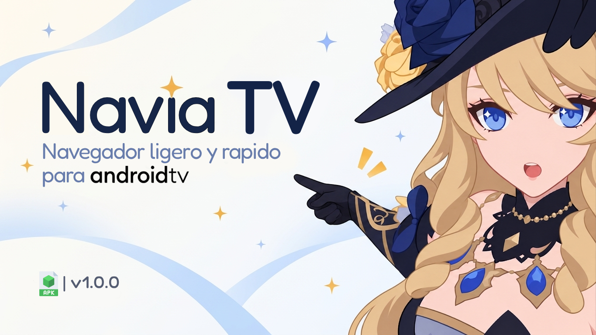

## Navia Browser TV

[**Descargar APK**](https://github.com/pekorinz/Navia-Browser-TV/releases) · [**Reportar un problema**](https://github.com/pekorinz/Navia-Browser-TV/issues)

## Acerca del proyecto

**Navia Browser TV** es un navegador web ligero diseñado específicamente para Android TV y Google TV.

Busca ofrecer una experiencia de navegación sencilla, rápida y sin distracciones, utilizando únicamente el control remoto. Incluye navegación mediante D-Pad, soporte para plataformas de vídeo como YouTube TV, bloqueo de anuncios, DNS cifrado (DoH) y un sistema de actualizaciones integrado.

## Características principales

### Navegación y control remoto

Diseñado para utilizarse con el mando a distancia, sin necesidad de mouse ni pantalla táctil.

- **Modo FOCO:** permite moverse entre enlaces, botones y otros elementos interactivos utilizando las flechas del control remoto.
- **Modo CURSOR:** muestra un puntero virtual que puedes controlar con el D-Pad. Incluye velocidades lenta, media y rápida.
- **Modo SCROLL:** permite desplazarse vertical y horizontalmente por las páginas.
- **Accesos rápidos:** mantén presionado el botón `ATRÁS` para abrir el menú de herramientas o el panel exclusivo de YouTube TV.

### Bloqueo de anuncios y privacidad

Navega por Internet con menos anuncios y rastreadores.

- **Filtros integrados:** más de 100 000 dominios y 9500 reglas de rutas locales.
- **Listas de bloqueo:** compatibilidad con Adblock Plus y EasyList, con descargas y actualizaciones automáticas.
- **Lista blanca:** permite activar o desactivar el bloqueo para sitios específicos.
- **Estadísticas:** consulta las peticiones y los elementos bloqueados por página, por día y en el historial.

### DNS cifrado (DoH)

Incluye un sistema DNS local que permite realizar consultas cifradas mediante HTTPS.

Proveedores disponibles:

- **Cloudflare:** `1.1.1.1`
- **Google:** `8.8.8.8`
- **Quad9:** `9.9.9.9`
- **AdGuard:** `dns.adguard.com`

También permite configurar servidores DNS personalizados, como NextDNS y otros servicios compatibles con DoH.

Incluye una caché interna para acelerar las consultas de dominios frecuentes.

### YouTube TV y funciones adicionales

Navia incorpora ajustes específicos para mejorar la experiencia de navegación y reproducción en YouTube TV.

- **Bloqueo de anuncios:** utiliza scripts para gestionar elementos publicitarios durante la reproducción.
- **Ajustes del reproductor:** corrige algunos elementos visuales, como las cajas negras de los controles, y añade un fondo suave para mejorar la lectura del texto.
- **Prevención de pausas:** mantiene activa la sesión para evitar interrupciones por inactividad.
- **Panel exclusivo:** incluye una barra inferior con accesos rápidos para cambiar ajustes sin salir del vídeo.

### Actualizaciones automáticas

Mantén el navegador actualizado sin tener que buscar manualmente cada nueva versión.

- Comprobación de nuevas versiones desde un servidor remoto.
- Pantalla integrada para consultar las novedades de cada versión.
- Descarga del APK e instalación desde el propio navegador.

### Pestañas, marcadores e incógnito

- **Gestor de pestañas:** panel lateral con vista previa de las páginas abiertas y opción para crear nuevas pestañas.
- **Marcadores:** guarda tus sitios favoritos para acceder a ellos rápidamente.
- **Modo incógnito:** permite navegar sin guardar el historial y limpia los datos temporales de la sesión al cerrarla.

## Temas e interfaz

Navia cuenta con dos temas que puedes cambiar en cualquier momento.

- **Modo oscuro:** tonos azul pizarra y fondos oscuros para ambientes con poca iluminación.
- **Modo claro:** interfaz clara y con buen contraste para espacios iluminados.

**Navegación por foco:** los botones y elementos seleccionados cuentan con efectos visuales suaves. Al utilizar el control remoto, el elemento enfocado se resalta claramente sin necesidad de bordes llamativos.

## Requisitos e instalación

### Requisitos del sistema

- **Sistema operativo:** Android 8.0 (API 26) o superior.
- **Dispositivos compatibles:** Android TV, Google TV, Fire TV Stick, Xiaomi TV Box, NVIDIA Shield TV y emuladores compatibles con Leanback.

### Instalación del APK

1. Descarga el APK desde la sección de [Releases](https://github.com/pekorinz/Navia-Browser-TV/releases).
2. Copia el archivo a una memoria USB o transfiérelo a tu televisor mediante una aplicación como Send Files to TV.
3. Activa la opción para instalar aplicaciones de fuentes desconocidas en los ajustes de Android TV.
4. Abre el administrador de archivos de tu televisor y selecciona el APK.
5. Sigue los pasos de instalación.

## Seguridad

El APK de producción fue analizado mediante **67 motores antivirus de VirusTotal**, incluyendo Kaspersky, ESET, Bitdefender, Google y Microsoft.

El análisis registró **0 detecciones** al momento de la revisión.

Puedes consultar el [reporte completo en VirusTotal](https://www.virustotal.com/gui/file/1da387fba083c574fe279d99030e4cce1f8c4f9bc37db34aac511688665ed246).

> Si algún día ves que tiene una detección, lo más probable es que hayas instalado un APK que no es el de este repositorio. Descarga siempre desde la sección de Releases de aquí.

## ¿Por qué Navia?

Navia Browser TV nació de una necesidad personal.

Aunque existen varios navegadores en la Play Store de Android TV, ninguno terminaba de convencerme. Algunos eran incómodos de utilizar, otros tenían demasiadas funciones y varios simplemente no ofrecían la experiencia que buscaba.

Por eso decidí crear uno propio.

Creo que **un navegador debe ser una herramienta que te permita hacer lo que quieras en Internet**, sin imponer funciones innecesarias ni complicarte las cosas.

Navia busca ofrecer justamente eso: una interfaz limpia, rápida y sencilla, donde tú tienes el control de la navegación desde tu mando a distancia.

Y sí, también estaba harto de tener que aguantar los anuncios de YouTube, que a veces parecen durar más que el propio vídeo y creo que si pudiesen ponerle anuncios a los tomacorrientes, ya lo hubieran hecho.

## Créditos y licencia

Desarrollado por **[Pekorinz](https://github.com/pekorinz)**.

Navia toma como referencia la sencillez de algunos navegadores móviles minimalistas, pero cuenta con una interfaz y funciones rediseñadas para ofrecer una experiencia adaptada a Android TV.

---

**Navia Browser TV**

